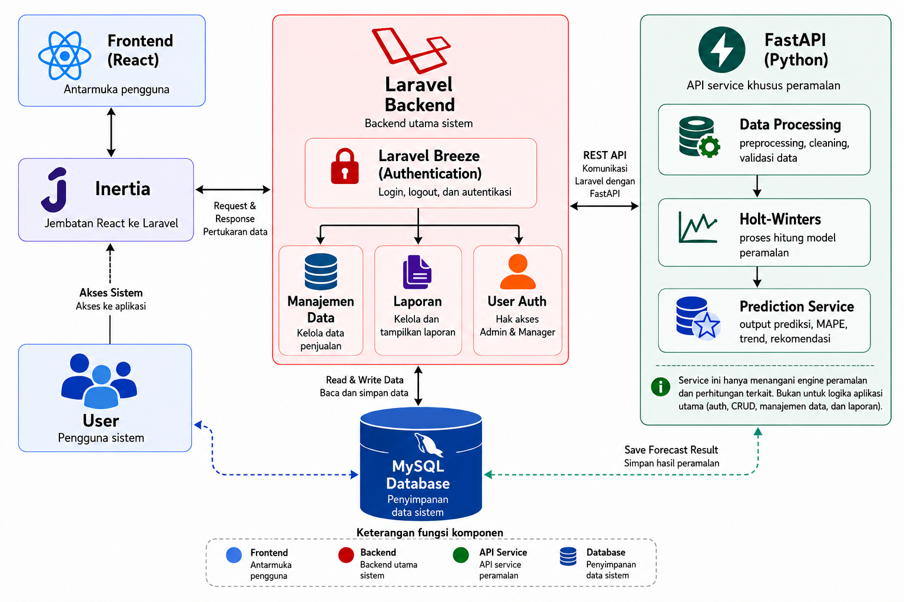
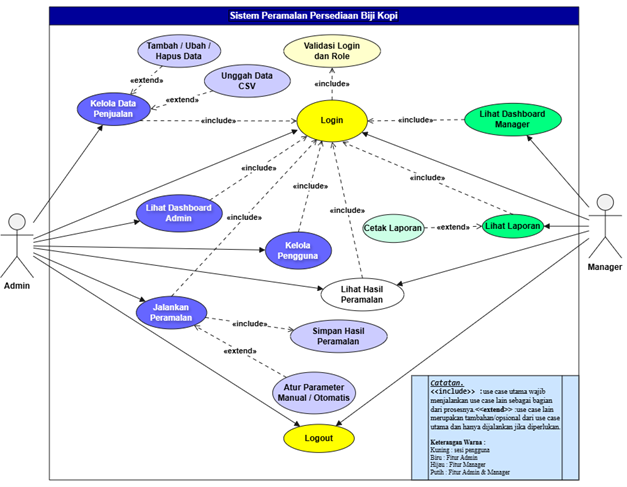

<div align="center">

# ☕ Coffee Bean Sales & Stock Forecasting System

**A full-stack web application that forecasts coffee bean sales to help a company plan its warehouse stock, built with the Holt-Winters method.**


*Final-year thesis project · Informatics Engineering, Institut Teknologi Padang*

</div>

---

## 📌 Overview

This system was built to solve a real problem found at a coffee bean company in Kerinci: the company struggled to plan its stock purchases and warehouse inventory.

Coffee beans are a sensitive product because they easily absorb the temperature and humidity around them, so stock level mistakes are costly in both directions:

- **Sales suddenly drop** → unsold stock piles up in the warehouse → bean quality declines.
- **Sales suddenly rise** → the company is overwhelmed finding suppliers and extra coffee to meet demand.

To address this, the system forecasts future sales per coffee category so the company can prepare its stock earlier and more accurately.

## 🎯 Results

| Metric | Result |
|---|---|
| Forecast horizon | 6 months ahead |
| Coffee categories | 3 |
| Average MAPE | **below 20%** (rated *Good*) |
| Data | Real sales data from the company, fluctuating and with a long forecast horizon |

## 🧠 Why Holt-Winters?

The system uses **Holt-Winters exponential smoothing**, a classic time-series forecasting method built on pure mathematical techniques. It was chosen because the historical data available at the company is limited, and the method works well on data with level, trend, and seasonal patterns.

## ✨ Features

**Admin**
- Secure login with role validation
- Manage sales data: add, edit, delete, and bulk upload through CSV
- Run forecasts with manual or automatic parameters, and save the results
- View the admin dashboard and forecast results
- User management

**Manager**
- Secure login with role validation
- View the manager dashboard
- View forecast results
- View and print reports

## 🏗️ System Architecture

The application is a **Single Page Application (SPA)** with a hybrid architecture. Laravel handles the main application logic, and a separate FastAPI service acts as the dedicated forecasting engine.

| Layer | Technology | Role |
|---|---|---|
| Frontend | React.js | User interface |
| Bridge | Inertia.js | Connects React to Laravel as an SPA |
| Backend | Laravel 12 (with Breeze) | Authentication, sales data management, reports, role-based access |
| Forecasting engine | FastAPI (Python) | Data preprocessing, Holt-Winters model, prediction output (forecast, MAPE, trend) |
| Communication | REST API | Laravel ↔ FastAPI |
| Database | MySQL | Stores system data and forecast results |



### How a forecast runs
1. The Admin enters sales data manually or uploads a CSV file.
2. Laravel stores the data in MySQL.
3. The Admin runs a forecast, choosing manual or automatic parameters.
4. Laravel sends the request to the FastAPI service through the REST API.
5. FastAPI cleans and validates the data, applies the Holt-Winters model, and returns the forecast along with its accuracy (MAPE) and trend.
6. The forecast result is saved to the database.
7. The Manager views the results on the dashboard and in printable reports.

## 👥 Use Case Diagram



## 🚀 Getting Started

### Prerequisites
- PHP 8.2+ and Composer
- Node.js and npm
- Python 3.10+
- MySQL

### 1. Clone the repository
```bash
git clone https://github.com/DoriFransDika/Sistem-Peramalan-Penjualan-Menggunakan-Holt-Winters.git
cd Sistem-Peramalan-Penjualan-Menggunakan-Holt-Winters
```

### 2. Set up the Laravel application
```bash
composer install
npm install
cp .env.example .env
php artisan key:generate
```
Edit `.env` with your own database credentials and the URL of the forecasting service, then run:
```bash
php artisan migrate --seed
npm run dev
php artisan serve
```

### 3. Set up the FastAPI forecasting service
```bash
cd <forecasting-service-folder>
python -m venv venv
source venv/bin/activate        # Windows: venv\Scripts\activate
pip install -r requirements.txt
uvicorn main:app --reload --port 8001
```

> Replace the folder name and the `uvicorn` entry point with the ones used in this repository.

## 📁 Project Structure

```
├── app/ routes/ resources/ ...   # Laravel + React (Inertia) application
├── <forecasting-service>/        # FastAPI forecasting engine
├── docs/images/                  # Architecture and use case diagrams
└── README.md
```

## 👤 Author

**Dori Frans Dika**
Informatics Engineering graduate, Institut Teknologi Padang

[LinkedIn](https://linkedin.com/in/dori-frans-dika) · [GitHub](https://github.com/DoriFransDika) · [Portfolio](https://my-portfolio-alpha-nine-51.vercel.app/) · dorifransdikaa@gmail.com
